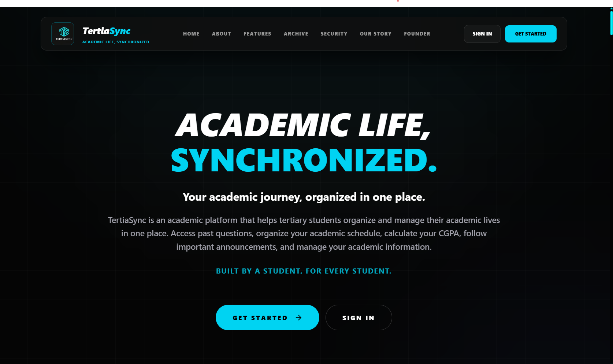
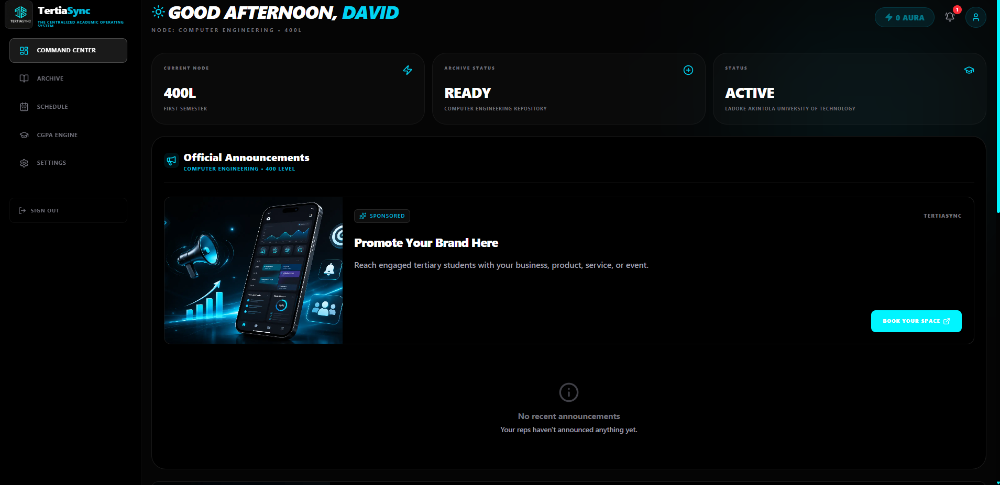
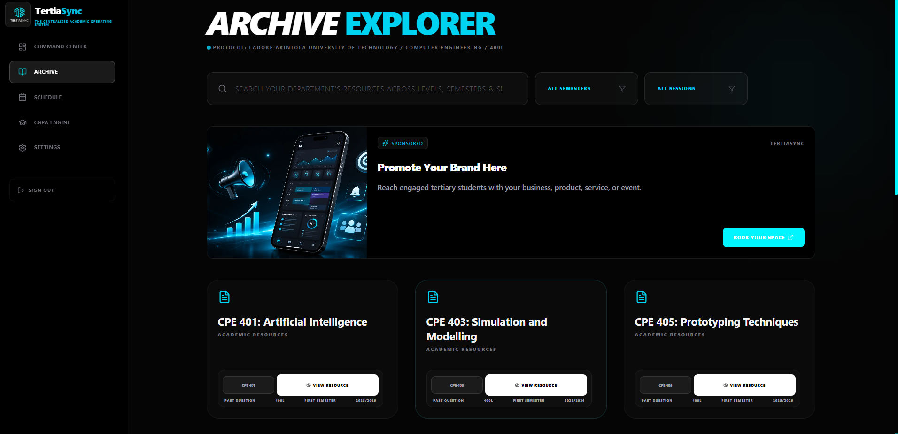

# TertiaSync

### Academic Life, Synchronized.

TertiaSync is an academic technology platform being developed to help students in Nigerian tertiary institutions organize and manage their academic lives through connected tools and resources.

It is built around a simple vision: making academic life more organized, accessible and synchronized.

🌐 **Website:** https://tertiasync.com

---

## About the Project

TertiaSync evolved from a past-question project initially started in 2025. In April 2026, the project grew into a broader academic platform designed to address multiple aspects of the student experience.

The long-term vision is to become a standard synchronization layer for Nigerian higher education.

## Preview

  

  <em>The TertiaSync landing page — Academic Life, Synchronized.</em>

## Student Dashboard

  

  <em>A connected academic workspace designed to help students manage their academic lives.</em>

## Past Question Archive

  

  <em>Discover and access academic resources in one organized archive.</em>

## Key Features

The platform brings together academic tools and resources, including:

- **Past Question Archive:** Access and discover academic resources.
- **Academic Schedule:** Keep track of important academic activities.
- **CGPA Tracking:** Monitor academic performance.
- **Study Planner:** Organize study activities.
- **Departmental Updates:** Stay informed through department-level announcements.
- **Community Contributions:** Contribute academic resources to the student community.
- **Progressive Web App:** Access the platform through a web-based, app-like experience.

## Technology Stack

| Area | Technologies |
|---|---|
| Frontend | Next.js, React, TypeScript |
| Backend | Supabase |
| Database | PostgreSQL |
| Authentication | Supabase Auth |
| Storage | Supabase Storage |
| Deployment | Vercel |
| Application Experience | Progressive Web App (PWA) |

## Project Status

**Currently in development.**

TertiaSync is being developed with an initial focus on students at LAUTECH, with a broader vision of supporting students across Nigerian tertiary institutions.

## Project Vision

To make academic life less scattered by bringing essential academic tools, resources and student activities into one connected platform.

## Founder

**David Godspower Ajala**

Software Developer | Computer Engineering Student | Founder of TertiaSync

- Portfolio: https://davidgodspowerajala.me/
- GitHub: https://github.com/david-godspower
- LinkedIn: https://www.linkedin.com/in/david-godspower-ajala/

---

  <strong>Academic Life, Synchronized.</strong>

